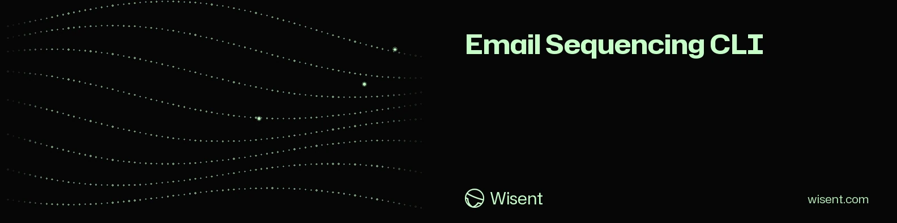

<!-- wisent-banner:start -->

  

<!-- wisent-banner:end -->

<!-- wisent-readme-signals:start -->
      
<!-- wisent-readme-signals:end -->

# email-sequencing-cli

Local planning and execution state for email sequences. It never sends
email. Every command reads JSON files and prints JSON, or with `--text` one
`path: value` line per field from the same document.

| Command | What it prints |
|---|---|
| `email-sequencing enroll --sequence <sequence.json> --enrollment <seed.json> [--at <RFC 3339>]` | the new enrollment; `--at`, else the seed's `enrolledAt`, else now |
| `email-sequencing enroll-all --sequence <sequence.json> --seeds <seeds.json\|contacts.csv> [--at <RFC 3339>]` | every seed enrolled as `enroll` enrolls one, all or none; the seeds are a JSON array, or a `.csv` sheet (RFC 4180) whose header names the seed fields with nested ones joined by a dot (`id,contact.id,contact.email,contact.variables.name,contact.variables.company.name`), an empty cell leaving its field unset, every value text; refused for an empty list, two seeds with the same enrollment id or the same contact (naming both), a row whose cell count differs from the header's and a row that is not a seed (naming its line), and a sheet ending inside a quoted cell |
| `email-sequencing schedule --sequence <sequence.json> --enrollment <enrollment.json>` | every step of one enrollment with the time it falls due |
| `email-sequencing plan --sequence <sequence.json> --enrollments <enrollments.json> [--at <RFC 3339>]` | the steps due across many enrollments at `--at` (now when omitted) |
| `email-sequencing outbox --sequence <sequence.json> --enrollments <enrollments.json> [--at <RFC 3339>]` | every message `plan` finds due at `--at` (now when omitted), written out for its contact: `to`, the contact's email (`null` without one), the `subject` and `body` with the contact's `variables` filled (`{{name}}`, `{{company.name}}`), the variables it lacks under `missing`, `state` (`pending`), and `ready`, whether it has an address and every variable; nothing is sent or recorded — `record` keeps a `sent` event once a mailer sent it |
| `email-sequencing preview --sequence <sequence.json> --enrollment <enrollment.json>` | every step of one enrollment, in the sequence's order, written out the way `outbox` writes a message, whatever its `state` (`sent`, `skipped` or `pending`) and however far off its `dueAt`: the sequence read through as one contact will read it, before anyone is enrolled for real; refused when the enrollment names another sequence |
| `email-sequencing check --sequence <sequence.json> --enrollments <enrollments.json>` | what would stop the sequence's messages before it starts sending: per step (`stepId`), the enrollments whose contact has no address (`withoutAddress`) and, per variable the step's subject or body names, the enrollments whose contact lacks it (`missing`), every step written out for every enrollment whatever its state or due time; refused for an enrollment of another sequence |
| `email-sequencing stopped --enrollments <enrollments.json>` | every contact a reply, a bounce or an unsubscribe stopped, across enrollments of any sequences, the earliest stop first: `contactId`, `email`, `enrollmentId`, `sequenceId` and the `event` that ended it; the list a mailer checks before writing to someone again from another sequence |
| `email-sequencing record --enrollment <enrollment.json> --event <event.json>` | the enrollment with the event added (`sent`, `skipped`, `replied`, `bounced`, `unsubscribed`) |
| `email-sequencing record-all --enrollments <enrollments.json> --events <events.json>` | the whole set, in its order, with every event recorded on its enrollment as `record` records one, in the order given; `events.json` is an array of `{enrollmentId, event}`, the way a mailer's send log or a reply feed lists them. All or none: an entry naming an enrollment the set does not hold, an event `record` refuses, an empty events file or a set holding one enrollment id twice is refused naming the entry, and nothing is recorded |
| `email-sequencing forecast --sequence <sequence.json> --enrollments <enrollments.json> --days <n> [--at <RFC 3339>]` | how many messages fall due on each of the `--days` UTC days starting with the day of `--at` (now when omitted), over every pending step of every active enrollment not stopped by a reply, bounce or unsubscribe: `days`, each `day`, its `messages` and `byStep`; `overdue`, the steps already due, which go out at once; and `peak`, the busiest day's messages, the number a sender's daily quota must cover. Nothing is sent or recorded; a `--days` that is not above zero is refused |
| `email-sequencing opt-out --enrollments <enrollments.json> --contact <id or email> --reason <text> [--at <RFC 3339>]` | a person who asked to hear no more taken off every sequence at once: each enrollment, of any sequence, whose contact id is `--contact` or whose email is, case set aside, still active or paused is cancelled as `status --set cancelled` cancels one, the reason and moment kept on each. `cancelled`, the enrollments it cancelled; `alreadyEnded`, the contact's enrollments that were completed or cancelled already and are left so; and `enrollments`, the whole set to write back. Refused with nothing changed when no enrollment names the contact, and for an empty contact or reason |
| `email-sequencing render --template <template.txt> --variables <variables.json>` | the template with its variables filled |
| `email-sequencing report --sequence <sequence.json> --enrollments <enrollments.json>` | how the sequence is doing: how many enrollments stand `active`, `paused`, `completed` and `cancelled`, and per step, in the sequence's order, the messages `sent` and `skipped` and the `replied`, `bounced` and `unsubscribed` events that came after it was sent last in an enrollment (`beforeAnyStep` holds those that came before anything was sent); refused for an enrollment of another sequence and for an event naming a step the sequence does not hold |
| `email-sequencing status --enrollment <enrollment.json> --set active\|paused\|cancelled [--at <RFC 3339>] [--reason <text>]` | the enrollment moved to that status by hand, the change kept as an event of that type with its moment (`--at`, now when omitted) and reason; `plan` leaves out an enrollment that is not active. Refused for `completed` (a reply, bounce or unsubscribe recorded with `record` completes one), for the status it already has, and for a completed or cancelled enrollment, which nothing reopens |

`--help` works on the program and on every command. Exit 2: the invocation
is wrong (unknown command or flag, missing argument); exit 1: an input file
could not be read, is not valid JSON, or was refused, with the reason on
stderr.
